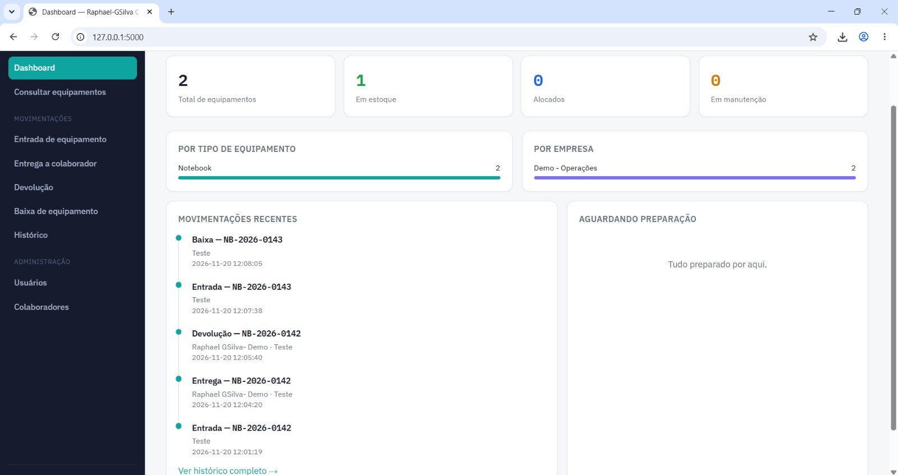
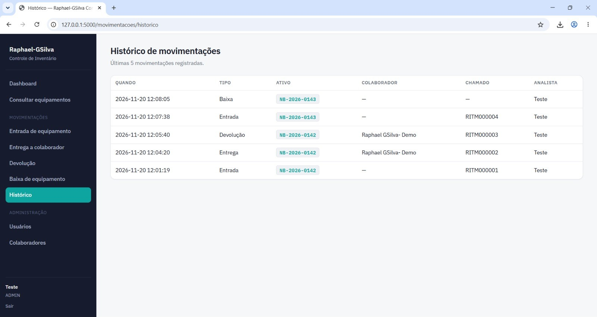
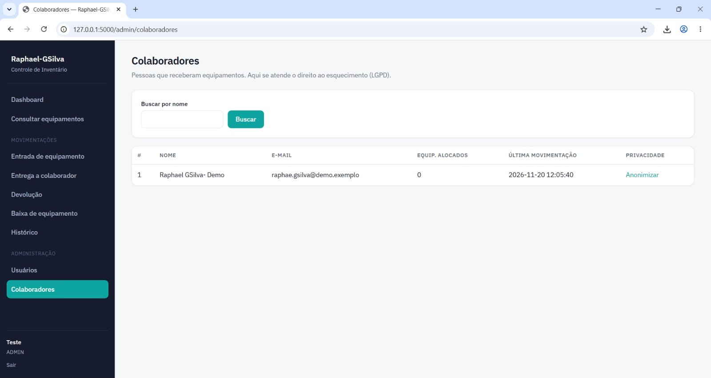

# Raphael-GSilva Controle de Inventário

Sistema de controle de inventário de equipamentos: entrada, entrega, devolução, baixa, consulta e
dashboard, com login via Microsoft Entra ID e sincronização opcional com planilha do SharePoint/OneDrive.

Nasce 100% zerado — nenhuma empresa, tipo de equipamento ou dado de exemplo pré-carregado. As listas
crescem com o uso, ou você carrega tudo com `scripts/importar_excel.py`.

## Screenshots

### Dashboard



### Histórico


### Colaboradores


## Decisões de projeto

1. **Banco local (SQLite) é a fonte da verdade**; a sincronização com o SharePoint é em segundo plano e nunca bloqueia nem desfaz uma operação.
2. **Dependências mínimas**: Flask, `msal`, `openpyxl`, `requests`, `python-dotenv`. Sem ORM, sem Flask-Login/WTF — CSRF em `app/csrf.py`.
3. **Zero dado embutido**: empresas e tipos de equipamento vêm do que já está no banco.

**160 testes automatizados** (`python -m unittest discover -s tests`).

## Ciclo de vida de um equipamento

```
Entrada → Em estoque → Entrega → Alocado → Devolução → Em estoque
                                                      ↘ Em manutenção (condição Ruim)
Em estoque / Em manutenção ── Baixa → Baixado
```

Não é possível baixar equipamento alocado (devolva antes). Menu: **Movimentações > Baixa de equipamento**.

## Segurança (Fase 1)

### Security headers (`app/security.py`)
Enviados em **todas** as respostas:

| Header | Valor / efeito |
|---|---|
| `Content-Security-Policy` | `default-src 'self'`; scripts só do próprio site (sem inline); estilos/fontes do Google Fonts; `frame-ancestors 'none'`; `form-action 'self'` |
| `X-Frame-Options` | `DENY` (anti-clickjacking) |
| `X-Content-Type-Options` | `nosniff` |
| `Strict-Transport-Security` | `max-age=31536000; includeSubDomains` (vale quando servido por HTTPS) |
| `Referrer-Policy` | `strict-origin-when-cross-origin` |

Como o CSP bloqueia JavaScript inline, os templates **não usam** `onclick`/`<script>` inline.

### Rate limit no login
- **5 tentativas por minuto por IP** em `POST /login`, `/auth/*` (callback Microsoft) e `/login/*`. Excedeu → **HTTP 429**.
- `RATE_LIMIT_ENABLED=false` desliga (só para desenvolvimento).
- O IP é o do socket. `X-Forwarded-For` **só é considerado** com `TRUST_X_FORWARDED_FOR=true` (use apenas atrás de proxy reverso confiável; senão qualquer um burlaria o limite trocando o header).
- **Limitação:** o contador fica em memória, por processo. Com vários workers/instâncias, cada um conta separado (para produção multi-instância, use um repositório compartilhado, ex.: Redis — previsto para uma fase futura).

### Validação e sanitização de entrada (`app/sanitize.py`)
- Todo campo de texto (ativo, série, tipo, modelo, empresa, owner, colaborador, chamado, observações) passa por `limpar()`: remove tags HTML, `<`/`>` e caracteres de controle, aplica limite de tamanho e descarta vazio. `<script>alert(1)</script>Acme` vira `alert(1)Acme`.
- Datas só aceitam `AAAA-MM-DD`.
- A **saída** continua protegida pelo autoescape do Jinja (defesa em profundidade; sem escape duplo — `O'Brien` aparece certo).
- Aplicado também em `scripts/importar_excel.py` e na importação do SharePoint.

### Isolamento multi-tenant real
- `tenant_id` em `empresas`, `equipamentos`, `movimentacoes`, `usuarios` e `audit_logs`. O tenant do usuário vem do claim `tid` do token Microsoft (modo `mock`: tenant único `''`).
- **Toda função de `app/repositories.py` exige `tenant_id`** (parâmetro posicional sem default → esquecer dá `TypeError`) e filtra por ele no SQL, inclusive escritas (`UPDATE ... WHERE id=? AND tenant_id=?`).
- Nº de ativo e nome de empresa são únicos **por tenant**. Usuário de uma empresa recebe 404 ao tentar abrir ativo de outra; buscas, dashboard, histórico, sugestões dos formulários e lista de usuários mostram só o próprio tenant. O primeiro usuário de cada tenant vira ADMIN dele.
- **Limitação:** o isolamento é lógico (mesmo arquivo SQLite). Para isolamento físico, use um banco por cliente.
- **Banco de versão anterior:** o esquema mudou (Fases 1 e 2). Se existir um `instance/inventario.db` antigo, o sistema para com uma mensagem clara — faça backup, apague o arquivo e reinicie (ou reimporte via planilha). Bancos da **Fase 2** são adotados automaticamente (ver "Migrations de banco").

### Audit log
Tabela `audit_logs(id, tenant_id, user_oid, acao, alvo, detalhes, ip, timestamp)`. Registra: `LOGIN_SUCESSO`, `LOGIN_FALHA`, `ENTRADA_ATIVO`, `ENTREGA_ATIVO`, `DEVOLUCAO_ATIVO`, `BAIXA_ATIVO`, `TROCA_PAPEL_ADMIN`, `BACKUP`, `COLABORADOR_CRIADO`, `COLABORADOR_ATUALIZADO`, `ANONIMIZAR_COLABORADOR`, `ANONIMIZAR_USUARIO`, `RETENCAO_APLICADA`. O log **não guarda nome/e-mail** (referencia por ID, ex.: `colaborador#12`) e grava o oid só como pseudônimo (HMAC). Falha ao gravar o log nunca derruba a operação.

### Já existia
CSRF em todo POST (`app/csrf.py`) · `SECRET_KEY` persistida em `instance/.secret_key` · papéis CONSULTA/ANALISTA/ADMIN checados no servidor · identidade Microsoft = (oid + tenant).

## Privacidade e LGPD (Fase 2)

Texto completo, com inventário de dados, finalidades, retenção e procedimento de atendimento ao titular, em **[PRIVACIDADE.md](PRIVACIDADE.md)** (modelo técnico — validar com o jurídico).

### Anonimização / direito ao esquecimento
- **Colaboradores** agora são uma entidade (`colaboradores`), com nome e e-mail (opcional) **cifrados**. A entrega reaproveita o colaborador de mesmo nome; e-mail diferente = homônimo (outro registro).
- Menu **Administração → Colaboradores → Anonimizar** (ADMIN, tela de confirmação, irreversível) ou, no código, `app/services/privacidade_service.anonimizar_colaborador()`. Apaga nome e e-mail e **mantém o histórico**, que passa a mostrar **"Colaborador Anonimizado #N"**. Nomes/e-mails citados nas observações das movimentações dele são substituídos (melhor esforço).
- Se o colaborador tem equipamento alocado, o sistema **bloqueia** (pode-se forçar, com registro). Usuários do sistema também podem ser anonimizados (**Administração → Usuários**; não vale para si mesmo) e têm o acesso encerrado.
- O sistema **não coleta CPF** (minimização). **Não alcança** cópias externas: planilha do SharePoint, exports e backups dentro da retenção — ver PRIVACIDADE.md.

### Criptografia de dados sensíveis (`app/crypto.py`)
- **Fernet** (via `cryptography`) cifra nome/e-mail do colaborador e nome/e-mail/oid dos usuários. Como Fernet não é determinístico, a busca usa **índices cegos** (HMAC-SHA256 com `DATA_INDEX_KEY`): permite achar por oid/e-mail/nome sem guardar o valor.
- `DATA_ENCRYPTION_KEY` aceita várias chaves separadas por vírgula (a 1ª cifra, todas decifram) → **rotação**: `python scripts/rotacionar_chave_dados.py` (passo a passo no cabeçalho do script).
- **Perder a chave = perder os dados cifrados.** Gere com `python scripts/gerar_chaves.py` e guarde no cofre. Em desenvolvimento as chaves ficam em `instance/.data_key` e `instance/.index_key`: apague-as **junto** com o banco, nunca só elas (e ao copiar o banco para outro lugar, leve as chaves).
- A criptografia é por campo; use **também** criptografia de disco no servidor. A busca por nome do colaborador roda em memória (adequada a milhares de registros).

### Retenção de dados
`python scripts/aplicar_retencao.py` (simula) / `--confirmar` (executa; agende). Padrões — **validar com o jurídico**:

| Dado | Padrão | Variável |
|---|---|---|
| Log de auditoria (inclui IP) | 365 dias | `RETENCAO_AUDIT_DIAS` |
| Colaborador sem ativo alocado e sem movimentação | 5 anos → anonimiza | `RETENCAO_COLABORADOR_ANOS` |
| Backups | 90 dias | `RETENCAO_BACKUP_DIAS` |

### Gerenciamento de segredos (`app/segredos.py`)
Ordem de resolução de `SECRET_KEY`, `DATA_ENCRYPTION_KEY` e `DATA_INDEX_KEY`:
1. variável de ambiente → 2. `NOME_FILE` (arquivo: Docker/Kubernetes secrets, Vault Agent, driver CSI) → 3. **Azure Key Vault** (`AZURE_KEYVAULT_URL`, nomes com hífen: `SECRET-KEY`) → 4. **HashiCorp Vault** (`VAULT_ADDR`, `VAULT_TOKEN`, KV v2) → 5. arquivo local em `instance/` — **só em desenvolvimento**.

Com **`APP_ENV=production`** o arquivo local nunca é lido nem criado: sem o segredo nas fontes 1-4 a aplicação **não inicia**. Também nesse modo são recusados `AUTH_MODE=mock`, CSRF desligado e rate limit desligado, e o debug nunca liga. Key Vault: `pip install -r requirements-azure.txt` e use identidade gerenciada (`DefaultAzureCredential`) — ver AZURE_SETUP.md. *As integrações com Key Vault/Vault foram testadas com simulações; teste contra o seu cofre real antes de produção.*

## Operação e DevOps (Fase 3)

### Migrations de banco (`app/migrations/`)
- Cada mudança de esquema é uma migração numerada em `app/migrations/versions/vNNNN_nome.py` (`VERSAO`, `DESCRICAO`, `aplicar(conn)`). A tabela `schema_migrations` guarda versão, descrição, data e **checksum** de cada uma. **Adicionar uma coluna não perde mais o banco**: crie a próxima migração (ex.: `conn.execute("ALTER TABLE equipamentos ADD COLUMN x TEXT")` em `v0003_...py`).
- Cada migração roda **numa transação**: se falhar, nada é alterado e a versão não é registrada. Vários processos iniciando juntos são seguros (lock + releitura).
- **Recusa iniciar** se uma migração já aplicada foi **alterada** (publicadas são imutáveis — há teste com checksum fixo), se o banco foi migrado por uma versão **mais nova** (sem downgrade) ou se o banco é anterior à Fase 2 (recriar).
- Banco criado na Fase 2 (sem controle de versão) é **adotado** como v0001 e recebe só o que falta (v0002 = índice usado na tela de colaboradores) — **sem perder dados**. Antes de migrar um banco com dados, o sistema faz **backup automático** em `BACKUP_DIR` (`MIGRATION_BACKUP=true`).
- Boot: `AUTO_MIGRATE=true` migra sozinho. Com `AUTO_MIGRATE=false` (várias réplicas/etapa de release) o app só sobe com o banco atualizado: rode antes `python scripts/migrar.py aplicar` (`status` mostra o que falta).

### Observabilidade
- **`GET /healthz`** (sem login, não vaza detalhes de erro, `Cache-Control: no-store`): `200` com `{"status":"ok","versao","checks":{"database":{latencia_ms,versao_schema,versao_esperada},"criptografia"}}`; **`503`** (`"degradado"`) se o banco falha, há migração pendente ou a criptografia não funciona. Usado pelo `HEALTHCHECK` do Docker.
- **Logs estruturados em JSON** (stderr), uma linha por evento: `ts`, `nivel`, `logger`, `mensagem` + campos (`evento`, `request_id`, `metodo`, `caminho`, `status`, `duracao_ms`, `ip`, `usuario_id`...). Eventos: `startup`, `http_request`, `migracao_*`, `restore`, `prova_restore`, `ledger_*`, `healthz_falha`. `LOG_LEVEL` e `LOG_FORMAT=json|texto`. Toda resposta traz `X-Request-ID` (aceita o de um proxy só se tiver formato seguro).
- **Privacidade dos logs:** nunca registram nome, e-mail, oid, **query string** (pode conter termo de busca) nem a **mensagem** de exceções; exceções saem como tipo + pilha (`arquivo:linha função`, sem texto de código). Coberto por testes.

### Backup com restore testado
- `python scripts/backup_banco.py` cria o backup em `BACKUP_DIR` **e o verifica na hora** (integridade do SQLite, chaves estrangeiras, versão do esquema, contagens e decifragem de uma amostra de campos com as chaves atuais). Sai com erro se a verificação falhar.
- `python scripts/restaurar_backup.py ARQUIVO` só **verifica**; com `--confirmar` restaura (**pare o sistema antes**): guarda cópia de segurança do banco atual, restaura pela API de backup do SQLite, aplica as migrações (backup antigo é atualizado), **reaplica as anonimizações do registro `anonimizacoes.jsonl`** (LGPD: quem foi anonimizado não volta) e confere integridade e contagens. Recusa backup de esquema mais novo que o código, corrompido ou que as chaves atuais não decifram.
- **Prova de restauração:** `python scripts/testar_restore.py [ARQUIVO]` restaura o backup mais recente num banco **temporário** (não toca na produção) e grava o relatório de evidência `BACKUP_DIR/provas_restore/prova_restore_*.json` (data, SHA-256, resultados, duração). Código de saída 0/1 — agende (ex.: semanal) e guarde os relatórios para a auditoria.

### Docker, CI e cadeia de suprimentos
- **Dockerfile** multi-stage (imagem final sem ferramentas de build), usuário **não-root**, `HEALTHCHECK` em `/healthz`, servidor `waitress`, `APP_ENV=production` por padrão e **SBOM** (CycloneDX) da imagem em `/app/sbom.cdx.json`. **docker-compose.yml**: volume `/data`, sistema de arquivos somente leitura, `cap_drop: ALL`, `no-new-privileges`; perfil `jobs` com `backup`, `testar-restore`, `retencao` e `migrar`:
  ```bash
  cp .env.example .env            # preencha; para testar: APP_ENV=development e AUTH_MODE=mock
  docker compose up -d --build    # http://localhost:${PORT:-8000}  (o .env.example define PORT=5000)
  docker compose --profile jobs run --rm backup
  docker compose --profile jobs run --rm testar-restore
  ```
- **CI** (`.github/workflows/ci.yml`, a cada push/PR): testes em Python 3.10–3.13, `pip-audit` (vulnerabilidades conhecidas, inclui transitivas), SBOM como artefato e build da imagem com consulta ao `/healthz`. `.github/dependabot.yml` abre PRs de atualização (pip, Docker, Actions).
- **Dependências travadas:** `requirements.txt` com versões exatas das diretas (+`requirements.in` com as faixas). O lock **completo com hashes** (transitivas) é gerado por `python scripts/gerar_lock.py` (precisa de internet e `pip install pip-tools`); commite o `requirements.lock` — o Dockerfile o usa automaticamente. SBOM de qualquer ambiente: `pip freeze | python scripts/gerar_sbom.py - --saida sbom.cdx.json`.
- **Não verificado no ambiente de desenvolvimento** (sem Docker/internet): o build da imagem, a execução do workflow no GitHub, o `pip-audit` e a geração do lock. Rode na primeira vez e corrija o que aparecer.

## Rodar localmente

```bash
python -m venv .venv
.venv\Scripts\activate          # Windows  (Mac/Linux: source .venv/bin/activate)
pip install -r requirements.txt
copy .env.example .env          # Windows  (Mac/Linux: cp .env.example .env)
python run.py
```

Abra `http://127.0.0.1:5000`. O primeiro a logar vira ADMIN. Próximos dias: `.venv\Scripts\activate` + `python run.py`.

## Papéis

| Papel | Pode |
|---|---|
| `CONSULTA` | Ver dashboard, consultar e histórico |
| `ANALISTA` | + entrada, entrega, devolução e baixa |
| `ADMIN` | + promover/rebaixar usuários do próprio tenant |

Recuperação: `python scripts/promover_admin.py email@empresa.com [tenant_id]`.

## Backup

```bash
python scripts/backup_banco.py
```
Cópia segura (API de backup do SQLite) em `backups/`. Agende no Agendador de Tarefas/crontab.

## Importar planilha

```bash
python scripts/importar_excel.py planilha.xlsx                 # simula
python scripts/importar_excel.py planilha.xlsx --confirmar     # grava (opcional: --tenant ID)
```

## Microsoft e SharePoint

Ver **AZURE_SETUP.md**.

## Colocando no ar para o time

```bash
waitress-serve --host=0.0.0.0 --port=5000 wsgi:app
```
(ou use o Docker — ver "Operação e DevOps").
Use HTTPS (proxy reverso) e `TRUST_X_FORWARDED_FOR=true` somente atrás de proxy confiável.

## Estrutura

```
app/  db.py · models.py · repositories.py · config.py · csrf.py · security.py · sanitize.py · audit.py
      crypto.py · segredos.py · retencao.py · backup.py · ledger.py · sbom.py · logging_config.py · observabilidade.py
      migrations/ (versions/v0001, v0002...) · services/ (movimentação, privacidade) · routes/health_routes.py
      auth/ · services/ · routes/ · sharepoint/ · templates/ · static/
docs/ Dashboard.png
scripts/ init_db · backup_banco · promover_admin · importar_excel · resolver_sharepoint_ids
         gerar_chaves · aplicar_retencao · rotacionar_chave_dados · migrar · restaurar_backup · testar_restore
         gerar_sbom · gerar_lock
Dockerfile · docker-compose.yml · wsgi.py · .github/workflows/ci.yml · requirements.in/.txt
PRIVACIDADE.md · requirements-azure.txt (opcional)
tests/   service · repositórios · rotas · csrf · importação · segurança · privacidade · devops (migrations, backup/restore/prova, healthz, logs, Docker/CI)
```
